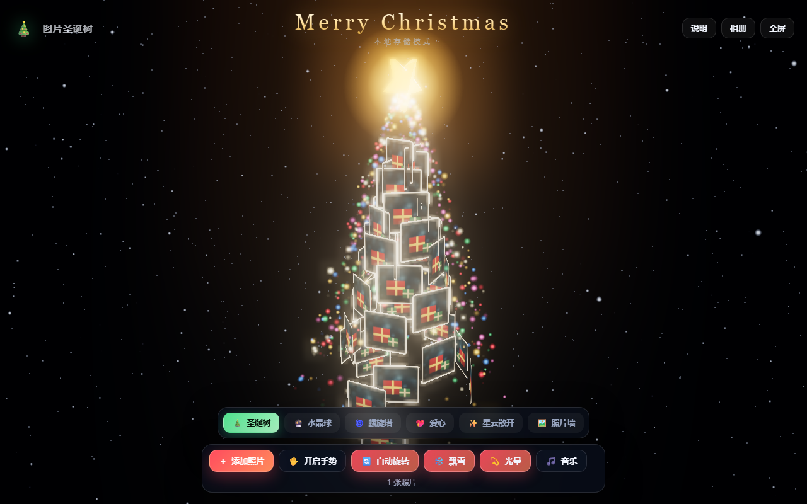
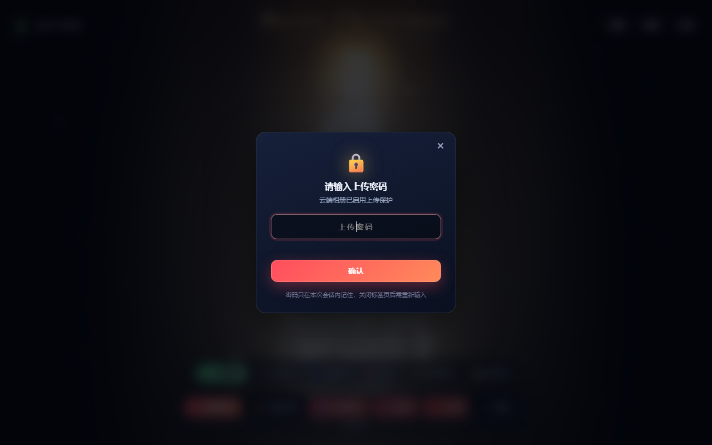

# 🎄 图片圣诞树 · 手势相册

[](https://github.com/MNB-54188/photo-christmas-tree)

[](LICENSE)

用你自己的照片拼成一颗 3D 圣诞树，**摄像头手势控制**、雪花、彩灯、多种造型，部署在 **Cloudflare Pages + D1 + KV** 上，无需任何传统服务器。

## 🌐 部署信息

- Pages 项目：`photo-christmas-tree`
- D1：`photo-tree-db`（`6f3cd8d5-bb59-4767-a893-64e7f4beb3ee`）
- KV：`PHOTOS_KV`（`08c1f14d836142f88229727458f85624`）
- 绑定已写入 `wrangler.toml`，以后改代码只需 `npm run deploy`



> 截图为内置示例照片跑出来的效果，实际会换成你自己的照片。

---

## ✨ 功能

| 功能 | 说明 |
|---|---|
| 🎄 照片圣诞树 | 照片自动铺满锥形圣诞树，照片少时自动重复成密集瓦片 |
| 🔮 6 种造型 | 圣诞树 / 水晶球 / 螺旋塔 / 爱心 / 星云散开 / 照片墙 |
| 🖐 手势控制 | 张开手掌旋转 · 捏合缩放 · 双手无级缩放 · 比耶换造型 · 握拳收回 · 指一下放大照片 |
| 🖱 鼠标/触屏 | 拖拽旋转、滚轮缩放、点击照片放大查看 |
| ☁️ 云存储 | 图片二进制存 **KV**，元信息存 **D1**，多设备共享 |
| 💾 本地降级 | 未部署 / 接口不可用时自动使用浏览器 IndexedDB，功能不受影响 |
| ❄️ 氛围 | 飘雪、闪烁彩灯、树顶星、礼物盒、辉光后处理、Jingle Bells 合成音乐 |

---

## 📁 项目结构

```
图片圣诞树/
├─ public/                  # 静态资源（部署到 Pages 的目录）
│  ├─ index.html            # 页面
│  ├─ styles.css            # 样式
│  ├─ _routes.json          # 只让 /api/* 走 Functions，其余走静态
│  ├─ js/
│  │  ├─ main.js            # 主控：UI、灯箱、手势联动、音乐
│  │  ├─ tree.js            # Three.js 圣诞树场景与造型布局
│  │  ├─ gestures.js        # MediaPipe 手势识别
│  │  └─ api.js             # 存储层（云端 KV+D1 / 本地 IndexedDB 自动切换）
│  └─ assets/samples/       # 内置示例照片（tools/gen_samples.py 生成）
├─ functions/               # Cloudflare Pages Functions（API）
│  ├─ _lib.js               # 公共工具（CORS / dataURL 解析）
│  └─ api/
│     ├─ photos.js          # GET 列表(D1) · POST 上传(KV+D1)
│     ├─ photos/[id].js     # DELETE 删除(KV+D1)
│     └─ raw/[id].js        # GET 图片二进制(KV)
├─ migrations/0001_init.sql # D1 建表脚本
├─ wrangler.toml            # Pages 高级模式配置
├─ docs/                    # 说明用截图
├─ test/                    # 自检脚本（手势单测、CDP 运行时/密码锁验收）
├─ tools/gen_samples.py     # 纯标准库生成内置示例照片
└─ package.json
```

自检：`npm run test:gesture`（21 条手势断言，纯 Node，不用浏览器）

---

## 🚀 一键部署到 Cloudflare

> 全程在项目根目录 `C:\Users\ma192\WorkBuddy\图片圣诞树` 下执行。

### 1. 安装依赖 & 登录

```bash
npm install
npx wrangler login
```

`wrangler login` 会打开浏览器，点 **Allow** 授权即可。

### 2. 创建 D1 数据库

```bash
npm run db:create
```

输出里会有一行 `database_id = xxxx-xxxx-...`，把它填进 `wrangler.toml` 的
`[[d1_databases]] database_id`。

### 3. 建表

```bash
npm run db:init:remote
```

### 4. 创建 KV 命名空间

```bash
npm run kv:create
```

把输出里的 `id = xxxx` 填进 `wrangler.toml` 的 `[[kv_namespaces]] id`。

### 5. 首次部署

```bash
npm run deploy
```

> 若提示 `Project not found`，先创建项目再部署：
> ```bash
> npx wrangler pages project create photo-christmas-tree --production-branch=main
> npm run deploy
> ```

> ⚠️ 如果首次部署后接口报 500，请到 Cloudflare 控制台
> **Workers & Pages → 你的项目 → Settings → Bindings**
> 确认存在 `DB`(D1) 和 `PHOTOS_KV`(KV) 两个绑定；`wrangler.toml` 已声明，一般会自动带上。

### 6. 日常更新

改完代码再执行一次 `npm run deploy` 即可。

---

## 💻 本地预览

```bash
npm run dev      # wrangler pages dev，会带 Functions 模拟
```

> 若 `wrangler login` 一直提示授权超时：系统代理会把回调地址 `localhost:8976`
> 也代理掉，导致浏览器跳不回来。解决：
> ```bash
> no_proxy="localhost,127.0.0.1,::1" NO_PROXY="localhost,127.0.0.1,::1" npx wrangler login
> ```

浏览器打开提示的 `http://localhost:8788`。

> 直接双击 `public/index.html` 也能看效果（降级为本地存储模式，接口自动跳过）。

---

## 🖐 手势一览

| 手势 | 效果 |
|---|---|
| 🖐 张开手掌移动 | 旋转 / 俯仰整棵树 |
| 🤏 捏合拇指食指拖动 | 旋转；捏合松紧 = 缩放 |
| 🤏🤏 双手捏合 | 拉开/靠拢 → 无级缩放 |
| ✌️ 比耶 | 下一张照片（未打开时先打开正中的那张） |
| ☝️ 伸食指 | 关闭照片放大界面（仅在照片打开时生效，避免误触） |
| 🤟 三指 | 上一个造型 |
| 🖖 四指 | 下一个造型 |
| ✊ 握拳 | 收回成圣诞树 |

键盘：`1`~`6` 切造型 · `空格` 自动旋转 · `G` 手势开关 · `M` 相册 · `H` 说明

> 手势模型由 jsDelivr / Google CDN 加载，首次开启需要联网；摄像头要求 **HTTPS 或 localhost**。

---

## 🔒 上传密码锁（默认关闭，需要你自己开）

> 仓库里**不含任何密码**：代码里是空占位符，想启用就按下面任一种方式设置。

启用后：

- **上传**：弹框输入密码，正确后本次会话内不再询问（关掉标签页需重输）
- **删除**：**每次都重新验证**密码，防止误删或他人操作
- 云端模式由 Pages Functions 在**服务端**校验，绕过页面直接调接口会返回 `401`；
  本地模式前端校验，可用顶部的 **🔒 密码** 按钮设置 / 修改 / 清除本机密码



### 方式 1：Cloudflare 密钥（推荐，不用改代码）

```bash
# 哈希方式（推荐，控制台里看不到明文）
node -e "console.log(require('crypto').createHash('sha256').update('你的密码').digest('hex'))" \
  | npx wrangler pages secret put UPLOAD_PASSWORD_SHA256

# 或者直接放明文
echo "你的密码" | npx wrangler pages secret put UPLOAD_PASSWORD
```

也可以在控制台 **Workers & Pages → photo-christmas-tree → Settings → Environment variables** 里加，
改完对新部署生效（密钥改了记得重新 `npm run deploy`）。

### 方式 2：写进代码（本地 + 云端同一个密码）

| 位置 | 内容 |
|---|---|
| `functions/_lib.js` | `BUILTIN_PASSWORD_SHA256` |
| `public/js/api.js` | `BUILTIN_HASH` |

两处填**同一个**哈希，然后 `npm run deploy`。
留空时：云端不启用锁；本地模式会在首次上传时让你**自己设一个**（存本机 localStorage）。

> 本地预览想带密码跑：`npx wrangler pages dev public --port 8788 -b UPLOAD_PASSWORD=你的密码`

---

## ⚙️ 常见问题

**上传报“单张照片不能超过 8MB”？**
前端会自动压缩到最长边 1400px、JPEG 82%，正常照片都在几百 KB。

**照片存在哪里？**
云端模式：图片本体在 KV（键 `photo:<id>`），宽高、名字、时间在 D1 的 `photos` 表。
本地模式：浏览器 IndexedDB。

**想清空重来？**
```bash
npm run db:init:remote        # 清空 D1（脚本含 DROP TABLE）
npx wrangler kv key list --binding=PHOTOS_KV   # 列出后逐个删除
```

---

## 📜 License

MIT
